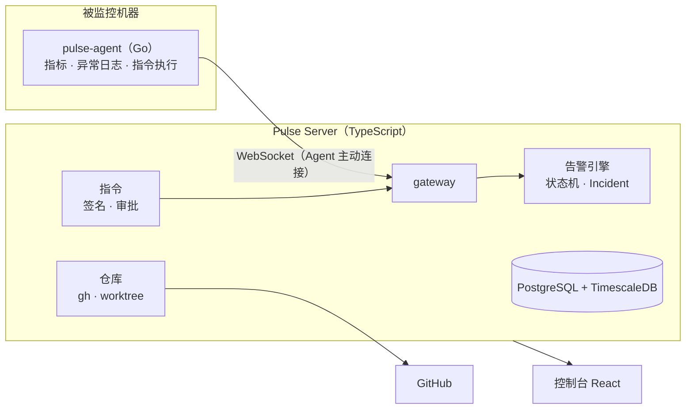

# Pulse

自托管的自动化运维监控。机器上的 Agent 采集指标和异常日志，中心服务器去重、聚合成 Incident，再结合 GitHub 代码仓库，用 Claude Agent SDK / Codex SDK 做根因分析。

- **一条命令装好 Agent**，5 分钟内在控制台看到实时曲线。
- **同一个问题只处理一次**：Agent 窗口计数 → 服务器日志指纹归组 → Alert 状态机（持续时间 + 滞回 + 抖动抑制）→ Incident 合并。10 万条同类报错加 30 分钟 CPU 满载，只产生 1 个 Incident。
- **安全的现场排查**：控制台和 AI 只能下发服务器签名的指令模板，Agent 验签、防重放、本地白名单兜底，写操作必须人工审批。
- **代码级根因**：服务绑定 GitHub 仓库，分析在对应部署版本的只读工作区上进行。
- **监控即脚本**（规划中）：用 TypeScript 写监控项，下发到 Agent 内嵌的 JS 沙箱；通过对外 MCP 在 Claude Code / Codex 里一句话新增监控。

> 项目处于早期阶段，接口和数据库结构仍可能变化。第一版只支持 Linux amd64 主机，按几十台规模、单进程服务端设计。

## 进度

| 里程碑 | 内容 | 状态 |
| --- | --- | --- |
| M1 采集与展示 | Agent 注册、指标与进程采集上报、离线补传、主机列表与详情、登录与总览 | 已完成 |
| M2 告警与去重 | 日志采集与指纹、规则引擎、Alert 状态机、Incident 合并、通知（飞书 / 企业微信 / 钉钉 / Slack / Webhook） | 已完成，[压测报告](docs/loadtest.md) |
| M3 指令与仓库 | 签名指令、审批、指令终端；gh 引导、仓库同步、服务版本关联 | 已完成 |
| M4 AI 分析 | Claude / Codex 适配、Pulse MCP 工具、分析报告、成本控制 | 进行中 |
| M5 自定义脚本与对外 MCP | goja 运行时、脚本发布流程、对外 MCP | 未开始 |

## 架构



Agent 与服务器之间只有一条由 Agent 发起的 WebSocket 长连接（zstd 压缩、按 seq 幂等、断线落盘补传），被监控机器不需要开放入站端口。完整设计见 [docs/design.md](docs/design.md)。

## 快速开始

### 1. 部署服务器

需要 Docker 与 Docker Compose。

```bash
git clone https://github.com/imythu/pulse.git
cd pulse/deploy
PULSE_PUBLIC_URL=https://pulse.example.com docker compose up -d
```

`PULSE_PUBLIC_URL` 必须是 Agent 能访问到的地址，安装命令会用它。镜像同时包含后端、前端和 Agent 二进制；建议放在 HTTPS 反向代理之后。

打开 `PULSE_PUBLIC_URL`，首次访问会进入初始化页面，创建第一个管理员。

### 2. 安装 Agent

控制台右上角「添加主机」，复制安装命令，在目标机器上执行：

```bash
curl -fsSL https://pulse.example.com/install.sh | sudo sh -s -- --token <令牌>
```

日志文件、服务版本、自定义指令等配置见 [docs/agent.md](docs/agent.md)。

### 3. 接入 GitHub（可选）

在「仓库」页按引导完成：检测 gh → 登录（`gh auth login` 或 `GH_TOKEN` 环境变量）→ 配置 git 凭据 → 选择仓库。Pulse 不保存 GitHub 凭据，所有访问都通过服务器上的 `gh`。然后在服务列表里把服务绑定到仓库（支持 monorepo 子目录）。

### 4. 配置通知

「设置」页添加通知渠道。只在 Incident 打开、升级、重开、恢复时通知，抖动中的告警暂停通知。

## 配置

服务器通过环境变量配置：

| 变量 | 默认值 | 说明 |
| --- | --- | --- |
| `DATABASE_URL` | — | PostgreSQL 连接串，需要 TimescaleDB 扩展 |
| `PULSE_PUBLIC_URL` | `http://localhost:8080` | 对外地址，用于安装命令和通知中的链接 |
| `PORT` / `HOST` | `8080` / `0.0.0.0` | 监听地址 |
| `PULSE_DATA_DIR` | `/var/lib/pulse` | 数据目录：指令签名密钥、仓库克隆、分析工作区 |
| `PULSE_SIGNING_KEY` | — | 指令签名密钥（base64 的 32 字节 Ed25519 种子）；不设置时读取或生成 `<数据目录>/signing.key` |
| `PULSE_OFFLINE_AFTER_SECONDS` | `45` | 多久没收到 Agent 消息判定离线（3 次心跳） |
| `GH_TOKEN` | — | 可选，供 gh 使用的 GitHub 令牌 |
| `LOG_LEVEL` | `info` | 日志级别 |

> **备份指令签名密钥**。Agent 注册时保存了它的公钥；密钥丢失后，已注册的 Agent 会拒绝新密钥签名的所有指令，需要逐台更新 `signing_public_key` 或重新注册。

## 本地开发

依赖：Node.js 22.15+（需要内置 zstd）、pnpm、Go 1.27+、带 TimescaleDB 扩展的 PostgreSQL 16、git。

```bash
pnpm install
cp apps/server/.env.example apps/server/.env   # 按需修改 DATABASE_URL
pnpm db:migrate
pnpm --filter @pulse/server dev                # http://127.0.0.1:8080
pnpm --filter @pulse/web dev                   # http://127.0.0.1:5173，/api 代理到后端
```

在本机跑一个 Agent：

```bash
cd apps/agent && make build
cat > /tmp/agent.yaml <<EOF
server: http://127.0.0.1:8080
data_dir: /tmp/pulse-agent
EOF
./bin/pulse-agent-linux-amd64 enroll --config /tmp/agent.yaml --token <控制台生成的令牌>
./bin/pulse-agent-linux-amd64 run --config /tmp/agent.yaml
```

目录结构：

```
apps/agent       Go Agent（pulse-agent）
apps/server      TypeScript 后端（Fastify + PostgreSQL/TimescaleDB）
apps/web         React 前端（Vite + Tailwind + React Bits）
packages/shared  前后端与 Agent 共用的协议、类型、指纹规则、指令模板
deploy/          install.sh、Dockerfile、docker-compose.yml
docs/            设计文档、Agent 配置、压测报告
```

## 测试

```bash
pnpm typecheck
pnpm --filter @pulse/server test         # 设置 TEST_DATABASE_URL 后运行集成测试（会清空该库）
cd apps/agent && go test ./...            # 含与 TS 共用的指纹用例和指令模板
```

Agent 二进制已构建时（`make build`），服务端集成测试会启动真实 Agent，验证跨语言的指令签名链路。压测方法见 [docs/loadtest.md](docs/loadtest.md)。

## 安全

发现安全问题请按 [SECURITY.md](SECURITY.md) 私下报告，不要公开提 Issue。

## 参与

欢迎 Issue 和 Pull Request，见 [CONTRIBUTING.md](CONTRIBUTING.md)。

## 许可证

[GNU Affero General Public License v3.0](LICENSE)（AGPL-3.0-only）。修改后以网络服务形式提供给他人使用时，需要向这些用户公开修改后的源码。
